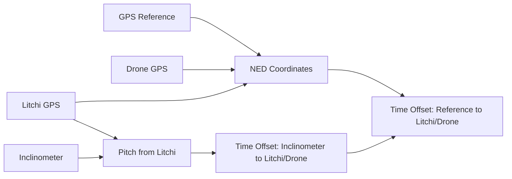

# Time Synchronization

Align data from multiple sources with different time bases.

## The Problem

Different data sources use different time references:

| Source | Time Base | Resolution |
|--------|-----------|------------|
| Sensor GPS | UTC (GNSS) | 1 ms |
| Drone (DJI) | Internal tick | 100 ms |
| Drone (ArduPilot) | Boot time | 1 ms |
| Inclinometer | Internal RTC | 10 ms |
| Camera | Frame index | 33 ms (30fps) |

Synchronization is essential for sensor fusion and accurate analysis.

## Synchronizer Overview



## Mathematical Description of the Calculations

### NED Position Correlation

The NED (North-East-Down) method correlates 3D position signals to find time offsets between GPS sources.

#### Step 1: LLA to ENU Conversion

Convert GPS coordinates to local East-North-Up (ENU) frame relative to reference point:

$$
\begin{aligned}
\Delta\text{lat} &= \text{lat}_{\text{target}} - \text{lat}_{\text{ref}} \\
\Delta\text{lon} &= \text{lon}_{\text{target}} - \text{lon}_{\text{ref}} \\
\\
E &= R \cdot \Delta\text{lon} \cdot \cos(\text{lat}_{\text{ref}}) \\
N &= R \cdot \Delta\text{lat} \\
U &= \text{alt}_{\text{target}} - \text{alt}_{\text{ref}}
\end{aligned}
$$

where $R = 6{,}371{,}000$ m (Earth radius)

#### Step 2: Interpolation to Common Timebase

Both GPS sources are interpolated to a common high-rate timebase (default 100 Hz):

$$
\begin{aligned}
t_{\text{common}} &= [t_{\text{start}}, t_{\text{start}} + \Delta t, \ldots, t_{\text{end}}] \\
\Delta t &= \frac{1}{f_{\text{target}}} = \frac{1}{100\text{ Hz}} = 0.01\text{ s}
\end{aligned}
$$

Interpolated signals:
- $E_1(t), N_1(t), U_1(t)$ - Reference GPS in ENU
- $E_2(t), N_2(t), U_2(t)$ - Target GPS in ENU

#### Step 3: Coarse Offset from the Cross-Correlation

The means are removed from each axis, so a constant position difference
between the two receivers (the lever arm between payload and drone antennas)
does not matter:

$$
x(t) = E_1(t) - \overline{E_1}, \quad y(t) = E_2(t) - \overline{E_2}
$$

The cross-correlations of the three axes are summed:

$$
R[k] = \sum_{\text{axes}} \sum_{t} x(t + k\,\Delta t) \cdot y(t)
$$

The peak of $|R[k]|$, refined by a parabola through the three samples around
it, gives the coarse offset $\tau_0 = k_{\text{peak}}\,\Delta t$. The sum runs
over fewer samples at larger lags, which pulls the peak towards zero lag. That
keeps a repeat of the flight pattern from matching, and the bias is removed by
the next step.

#### Step 4: Least-Squares Offset

The offset minimizes the mean-removed residual at the reference samples:

$$
\tau_{\text{offset}} = \arg\min_{\tau}\;
\frac{1}{N} \sum_{i} \left\| \mathbf{r}_i(\tau) - \overline{\mathbf{r}(\tau)} \right\|^2,
\qquad
\mathbf{r}_i(\tau) = \mathbf{p}_1(t_{1,i}) - \mathbf{p}_2(t_{1,i} - \tau)
$$

where $\mathbf{p}_2$ is linearly interpolated from the original target samples.
$\tau$ is scanned in steps of $\Delta t$ over
$\tau_0 \pm \max(2\text{ s}, |\tau_0|)$, and the minimum is refined between
the neighbouring steps.

#### Step 5: Correlation

The reported correlation is the Pearson correlation of the mean-removed
positions after alignment, over all axes (`correlation`) and per axis
(`correlations_enu`). `offsets_enu` are the coarse offsets of each axis.

#### Step 6: Spatial Offset After Time Alignment

After applying time offset, compute residual spatial offset:

$$
\begin{aligned}
t_2' &= t_2 + \tau_{\text{offset}} \\
E_2'(t_1) &= \text{interp}(E_2, t_2', t_1) \\
\\
\Delta E &= \text{mean}(E_2'(t_1) - E_1(t_1)) \\
\Delta N &= \text{mean}(N_2'(t_1) - N_1(t_1)) \\
\Delta U &= \text{mean}(U_2'(t_1) - U_1(t_1)) \\
\\
d_{\text{spatial}} &= \sqrt{\Delta E^2 + \Delta N^2 + \Delta U^2}
\end{aligned}
$$

### Pitch Correlation

#### Step 1: Interpolation to Common Timebase

Both pitch signals interpolated to high rate (100 Hz):

$$
\begin{aligned}
\theta_1(t) &= \text{interp}(\theta_{\text{Litchi}}, t_{\text{Litchi}}, t_{\text{common}}) \\
\theta_2(t) &= \text{interp}(\theta_{\text{Inclinometer}}, t_{\text{Inclinometer}}, t_{\text{common}})
\end{aligned}
$$

#### Step 2: Offset

The same two steps as for positions: coarse offset from the cross-correlation
of the mean-removed pitch, then least squares. A constant pitch bias does not
matter. If the two pitch signals have opposite signs (the peak of the
correlation is negative), the target pitch is flipped first.

#### Step 3: Chained Time Offset

Total time offset to align Inclinometer with GPS payload:

$$
\tau_{\text{Inclinometer→GPS}} = \tau_{\text{Inclinometer→Litchi}} + \tau_{\text{Litchi→GPS}}
$$

This two-stage approach allows synchronization even when Inclinometer and GPS don't share overlapping spatial trajectories, using Litchi gimbal as an intermediate reference.

#### Physical Interpretation

- **Time Offset** ($\tau$): Seconds to add to target timestamp to align with reference
- **Correlation** ($\rho$): Quality metric, range [0, 1]
    - $\rho > 0.9$: Excellent
    - $0.7 < \rho < 0.9$: Good
    - $\rho < 0.7$: Questionable
- **Spatial Offset** ($d$): Residual position error after time alignment (should be < 5m for good GPS)

## Resampling

With `common_time=True` every source is resampled on the reference time base
at its rate, by the same rules:

- **Time**: `timestamp` (UNIX seconds) is the only time column. Date and
  time columns, text columns and the other clocks (`unix_time_ms`,
  `timestamp_us`, `timestamp_ns`, `monotonic_ns`, `datetime_relative`) and
  `msg_type` are dropped; they stay in the raw data.
- **Missing values** are null: outside the time range of a source, and where
  the source has no value.
- **States, flags and counts** hold the last value and keep their type, so
  that a status bit field is never averaged. A column is one by its name
  (any `:`-separated part, any case): it contains `status`, `flag`,
  `flg`, `state`, `mode`, `sats`, or starts with `num` or `svn`, or is
  `isflying` or `week`; booleans too. Examples: `insStatus`, `RTK:pos_flg_0`,
  `GPS:numSV`, `Motor:Status:RFront`.
- **Angle columns** are interpolated the short way across the wrap: from
  179° to −179° the midpoint is −180°, not 0°. A column is an angle by its
  name (the part after the last `:`): `yaw`, `roll`, `pitch` and `heading`,
  with or without `gimbal`, `Abs` and `(deg)` (degrees), with `_rad`
  (radians), or with `Raw` (0.1°). The result keeps the range of the input,
  [−180°, 180°) or [0°, 360°).
- **Everything else** is interpolated linearly, as Float64.

| Table | Source | Rate key (default in `pils package`) |
|-------|--------|--------------------------------------|
| `drone` | drone GPS/RTK table | `drone` (100 Hz) |
| `litchi` | Litchi log | `litchi` (100 Hz; the drone rate if not given) |
| `inclinometer` | inclinometer INS table | `inclinometer` (100 Hz) |
| `adc`, `lm76`, `imu_<sensor>` | payload sensors | `payload` (100 Hz) |
| `drone_<record>` | DJI `.dat` records | `drone_records` (the drone rate) |
| `reference_gps` | payload GPS, the reference | `reference_gps` (100 Hz) |
| `camera` | camera | its own frame rate |

`flight.sync_rates` keeps the rates used; `pils package` saves them in the
synchronized revision (`user_target_rate`). The raw payload GPS, at its own
2 Hz, is in `raw_data`.

**Drone records** (DJI `.dat`, see [DJI Drone](dji-drone.md)) take the
drone GPS offset, since they are on the same clock. `Flight.sync`
synchronizes `IMU_ATTI(0)`, the flight controller attitude, by default, as
`drone_IMU_ATTI(0)`; pass `drone_records=[...]` or `drone_records="all"` for
others.

```python
flight.sync(target_rate={"drone": 100.0}, drone_records=["IMU_ATTI(0)", "Motor"])
flight.sync_data["drone_IMU_ATTI(0)"]  # roll, pitch, yaw, accel, gyro, ...
flight.sync_offsets  # {"drone_gps": 0.233, "litchi_gps": -0.187, "inclinometer": 0.306}
```

`flight.sync_offsets` keeps the detected offsets in seconds; as in the
offsets above, the inclinometer and camera ones are relative to Litchi.
`pils package` saves them in the synchronized revision (`user_time_offsets`).
